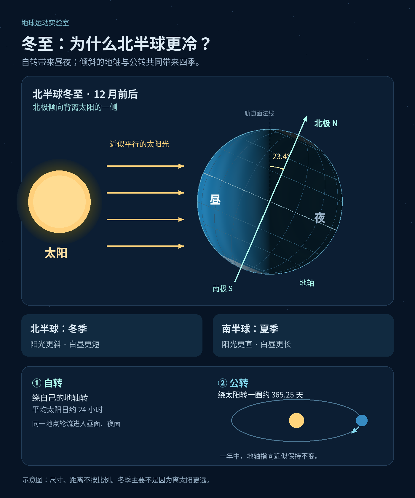

# 地球自转、公转与冬至

用可旋转的 3D 地球对比北半球冬至、夏至和春秋分。可以分别暂停自转、公转，拖动地球改变观察角度。

## 运行

克隆或下载仓库后，用现代浏览器打开本目录的 `index.html`。无需安装依赖，也不需要联网。

## 冬至图

地轴与轨道面垂线夹角约 23.4°。一年中，地轴在空间里的指向近似不变。图中大小、距离、速度不按实际比例；地表轮廓为教学示意。

可选：用 Python 运行 `draw_winter.py` 重绘 PNG（需要 Pillow、NumPy 和 Noto Sans CJK 字体）。非 Linux 或字体路径不同，可通过 `NOTO_CJK_REGULAR` 和 `NOTO_CJK_BOLD` 指定字体文件。

[科学参考：NASA · 四季的成因](https://spaceplace.nasa.gov/seasons/en/)
